# Niramoy project diagrams

These diagrams are derived from the current Next.js routes, services, repositories, and Drizzle schema. They describe the implemented system as of 2026-11-09.

## 1. System context

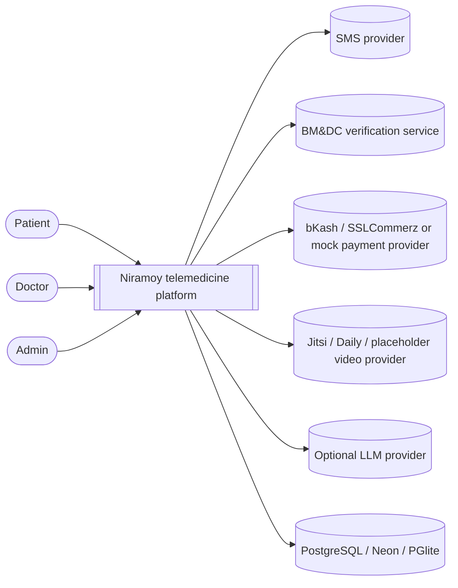

## 2. Use-case diagrams

### 2.1 Complete platform use cases

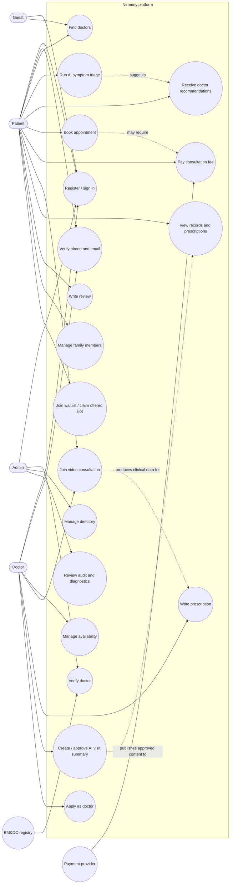

### 2.2 Doctor onboarding and verification use cases

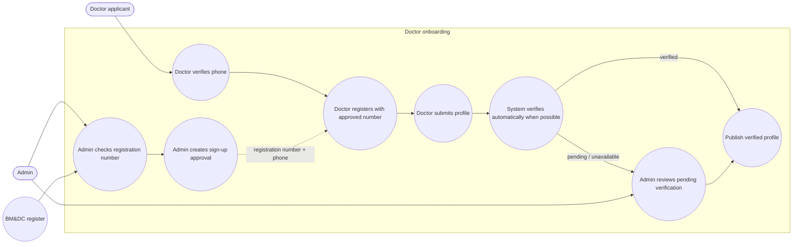

## 3. Sequence diagrams

### 3.1 Registration, phone verification, and session creation

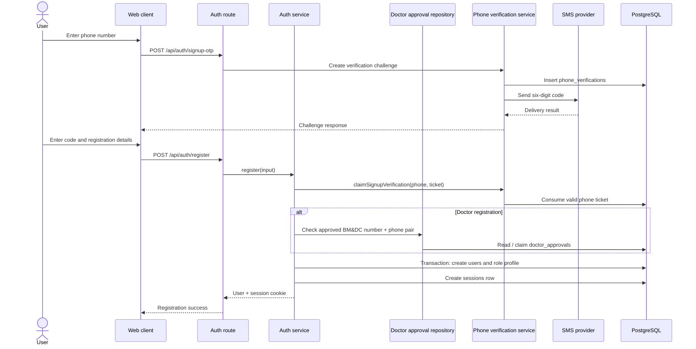

### 3.2 Appointment booking and payment

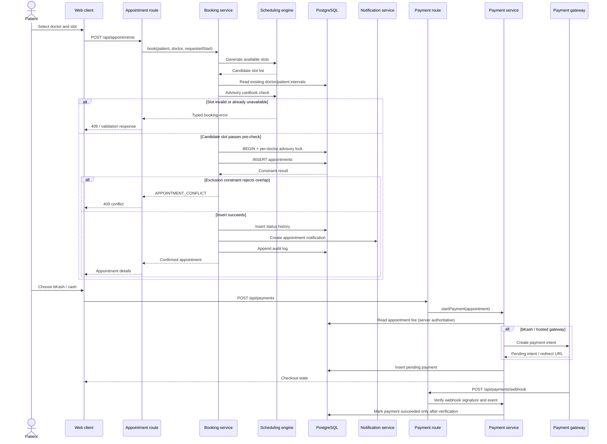

### 3.3 Consultation, video access, and clinical output

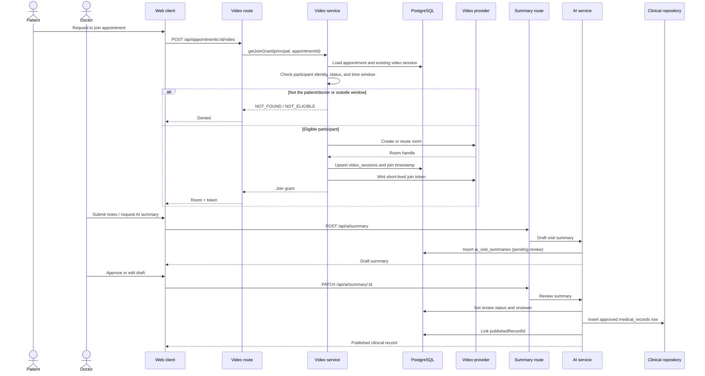

### 3.4 AI symptom triage and safety controls

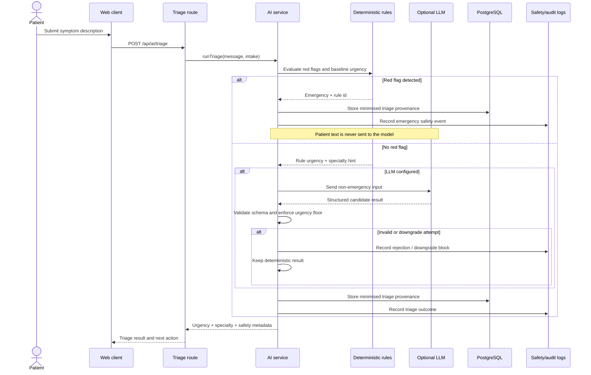

### 3.5 Doctor verification decision flow

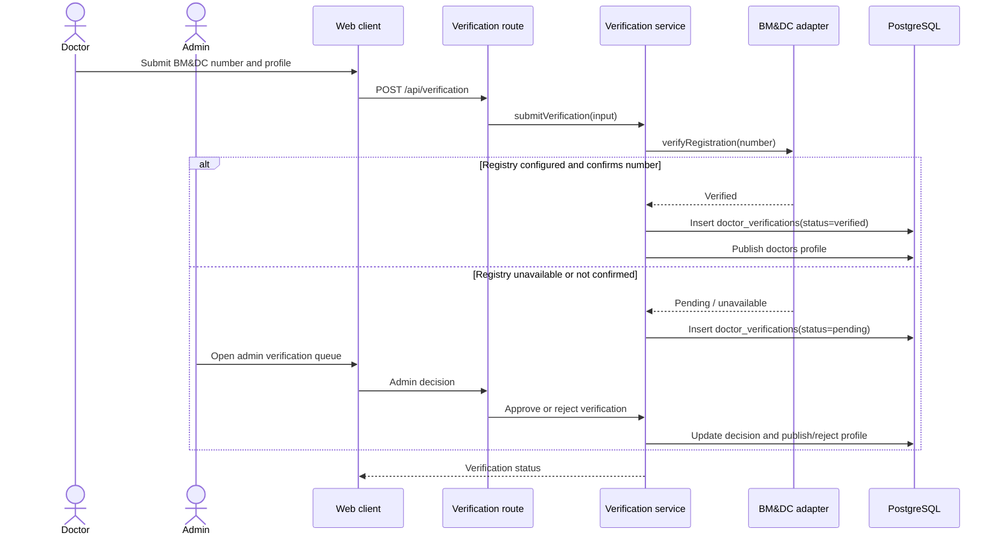

### 3.6 Waitlist offer and claim

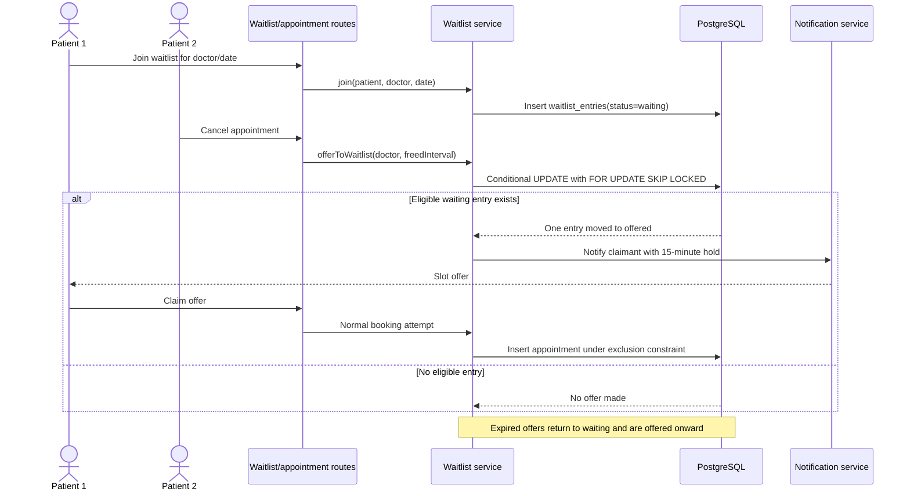

## 4. Class diagram

This is the domain class model. The persistent classes correspond to the Drizzle tables; service and provider classes show the main application abstractions around them.

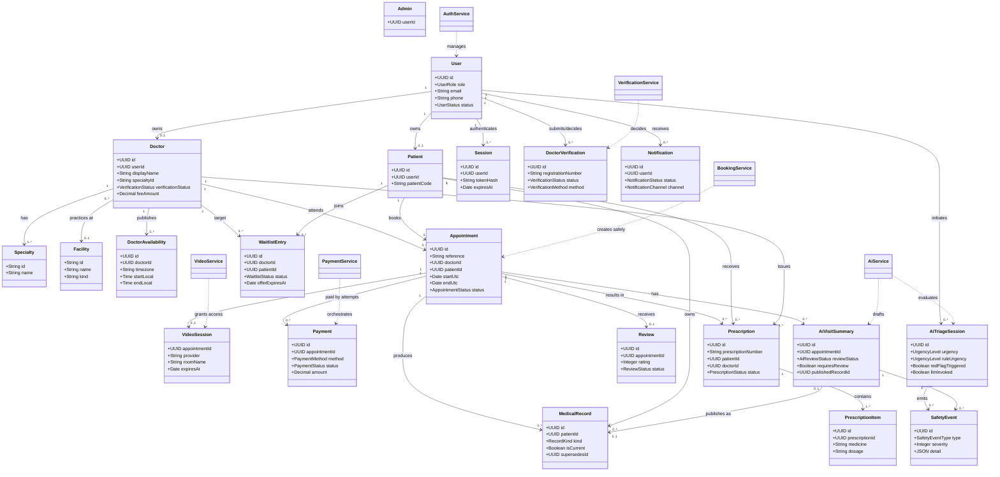

## 5. Entity–relationship diagram

```mermaid
erDiagram
    USERS ||--o| PATIENTS : has
    USERS ||--o| DOCTORS : has
    USERS ||--o{ SESSIONS : opens
    USERS ||--o{ AUTH_TOKENS : receives
    USERS ||--o{ PHONE_VERIFICATIONS : verifies
    USERS ||--o| FAMILY_ACCOUNTS : owns
    FAMILY_ACCOUNTS ||--o{ FAMILY_MEMBERS : contains
    PATIENTS ||--o{ FAMILY_MEMBERS : represents

    DIVISIONS ||--o{ DISTRICTS : contains
    DIVISIONS ||--o{ FACILITIES : locates
    DISTRICTS ||--o{ FACILITIES : locates
    SPECIALTIES ||--o{ DOCTORS : primary_specialty
    SPECIALTIES ||--o{ DOCTOR_SPECIALTIES : classifies
    DOCTORS ||--o{ DOCTOR_SPECIALTIES : has
    DOCTORS ||--o{ DOCTOR_LOCATIONS : works_at
    FACILITIES ||--o{ DOCTOR_LOCATIONS : hosts
    DOCTOR_VERIFICATIONS ||--o{ DOCTOR_DOCUMENTS : includes
    DOCTORS ||--o{ DOCTOR_VERIFICATIONS : has
    USERS ||--o{ DOCTOR_VERIFICATIONS : submits_or_decides
    USERS ||--o{ DOCTOR_APPROVALS : manages

    DOCTORS ||--o{ DOCTOR_AVAILABILITY : publishes
    DOCTORS ||--o{ AVAILABILITY_EXCEPTIONS : overrides
    DOCTORS ||--o{ APPOINTMENTS : attends
    PATIENTS ||--o{ APPOINTMENTS : books
    USERS ||--o{ APPOINTMENTS : books_or_cancels
    FAMILY_MEMBERS ||--o{ APPOINTMENTS : for
    APPOINTMENTS ||--o{ APPOINTMENT_STATUS_HISTORY : changes
    APPOINTMENTS ||--o| VIDEO_SESSIONS : opens
    DOCTORS ||--o{ WAITLIST_ENTRIES : targeted
    PATIENTS ||--o{ WAITLIST_ENTRIES : joins
    APPOINTMENTS ||--o| WAITLIST_ENTRIES : claimed_by

    PATIENTS ||--o{ MEDICAL_RECORDS : owns
    APPOINTMENTS ||--o{ MEDICAL_RECORDS : produces
    USERS ||--o{ MEDICAL_RECORDS : authors
    MEDICAL_RECORDS ||--o{ MEDICAL_RECORDS : amendment_chain
    APPOINTMENTS ||--o{ PRESCRIPTIONS : results_in
    PATIENTS ||--o{ PRESCRIPTIONS : receives
    DOCTORS ||--o{ PRESCRIPTIONS : issues
    PRESCRIPTIONS ||--o{ PRESCRIPTION_ITEMS : contains
    APPOINTMENTS ||--o| REVIEWS : receives
    PATIENTS ||--o{ REVIEWS : writes
    DOCTORS ||--o{ REVIEWS : receives

    USERS ||--o{ AI_TRIAGE_SESSIONS : initiates
    PATIENTS ||--o{ AI_TRIAGE_SESSIONS : relates_to
    SPECIALTIES ||--o{ AI_TRIAGE_SESSIONS : suggests
    APPOINTMENTS ||--o{ AI_VISIT_SUMMARIES : has
    DOCTORS ||--o{ AI_VISIT_SUMMARIES : reviews
    PATIENTS ||--o{ AI_VISIT_SUMMARIES : concerns
    MEDICAL_RECORDS ||--o{ AI_VISIT_SUMMARIES : published_record
    AI_TRIAGE_SESSIONS ||--o{ SAFETY_EVENTS : emits
    AI_VISIT_SUMMARIES ||--o{ SAFETY_EVENTS : emits
    APPOINTMENTS ||--o{ SAFETY_EVENTS : concerns

    USERS ||--o{ NOTIFICATIONS : receives
    APPOINTMENTS ||--o{ PAYMENTS : billed
    PATIENTS ||--o{ PAYMENTS : pays
    USERS ||--o{ PAYMENTS : payer
    PAYMENTS ||--o{ PAYMENT_WEBHOOK_EVENTS : receives
    USERS ||--o{ AUDIT_LOGS : acts
    USERS ||--o{ RATE_LIMIT_COUNTERS : limited
    USERS ||--o{ JOB_RUNS : owns
```

## 6. Relational mapping diagrams

### 6.1 Conceptual model to relational schema

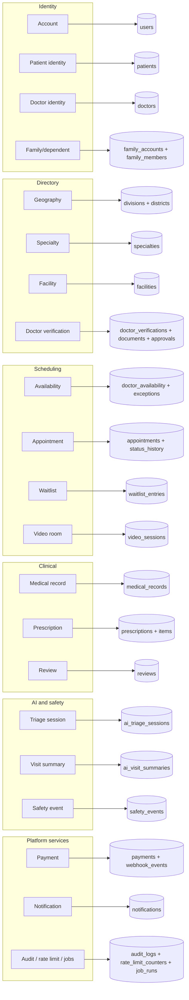

### 6.2 Relation inventory and key mapping

| Relational area | Relations | Primary key(s) | Main foreign-key links | Important integrity rule |
|---|---|---|---|---|
| Identity | `users`, `patients`, `sessions`, `auth_tokens`, `phone_verifications` | UUID per row | user → patient/session/token/verification | session tokens are stored hashed; phone tickets are consumed |
| Family access | `family_accounts`, `family_members` | UUID per row | account → member → patient/user | booking for a dependent is scoped to the owner’s household |
| Directory | `divisions`, `districts`, `specialties`, `facilities` | stable text IDs | district → division; facility → geography | reference vocabulary is stable and reusable |
| Doctors | `doctors`, `doctor_specialties`, `doctor_locations` | doctor UUID; composite join rows | doctor → user/specialty/facility/geography | only verified, non-suspended profiles are bookable |
| Verification | `doctor_verifications`, `doctor_documents`, `doctor_approvals` | UUID per row | verification → doctor/user/specialty/geography | verified status requires evidence; approval can be claimed once |
| Availability | `doctor_availability`, `availability_exceptions` | UUID per row | both → doctor | local time window + IANA zone converted to UTC |
| Scheduling | `appointments`, `appointment_status_history` | appointment UUID; history UUID | appointment → doctor/patient/user/family member | PostgreSQL exclusion constraint prevents live overlaps |
| Waitlist/video | `waitlist_entries`, `video_sessions` | UUID; appointment UUID for video | waitlist → doctor/patient/appointment | one expiring offer at a time; room access is participant-scoped |
| Clinical | `medical_records`, `prescriptions`, `prescription_items`, `reviews` | UUID; prescription number unique | clinical rows → appointment/patient/doctor/user | records and corrections are append-oriented; one review per appointment |
| AI safety | `ai_triage_sessions`, `ai_visit_summaries`, `safety_events` | UUID per row | AI rows → appointment/patient/doctor/user/record | urgency floor, human review, and no-red-flag downgrade constraints |
| Platform | `notifications`, `payments`, `payment_webhook_events` | UUID per row | notification/payment → user/appointment/patient | non-mock payment becomes succeeded only from verified webhook |
| Governance | `audit_logs`, `rate_limit_counters`, `job_runs` | UUID or composite logical key | audit/job → user | audit and safety streams are append-only; counters are durable/shared |

### 6.3 Core relational constraints

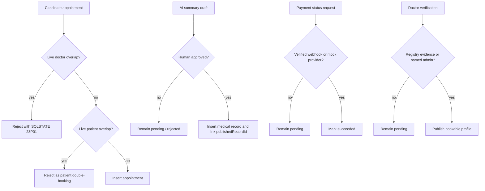

## 7. Implemented architecture boundary

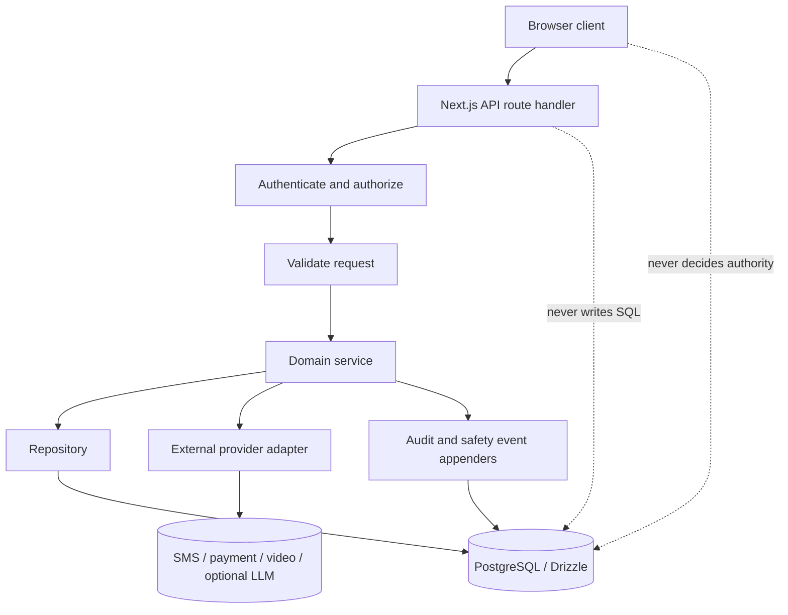

